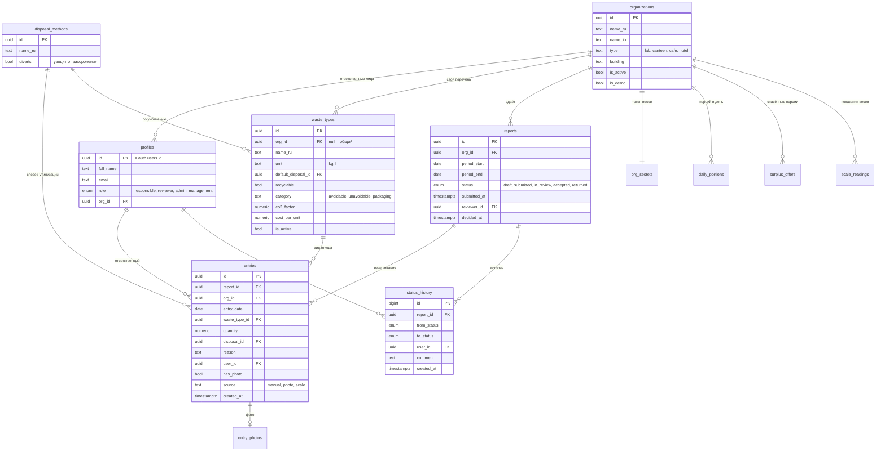
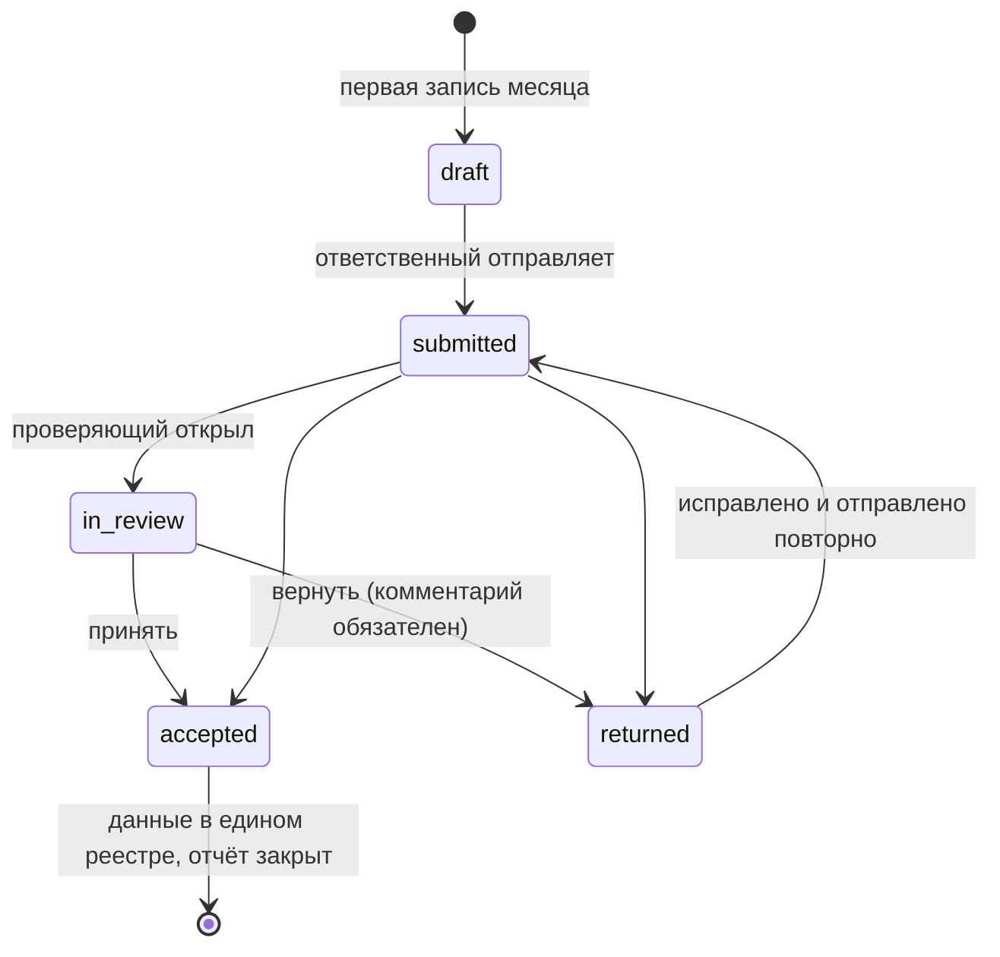

# ER-диаграмма Qadir

Правила модели:

- итоги за день и месяц нигде не хранятся — они считаются из `entries`;
- единый реестр — представление `registry`: записи отчётов со статусом `accepted`;
- вид отхода, по которому есть записи, нельзя удалить — только отключить (`is_active`);
- статус отчёта меняют только серверные функции, каждая смена пишется в `status_history`.

## Статусы отчёта

